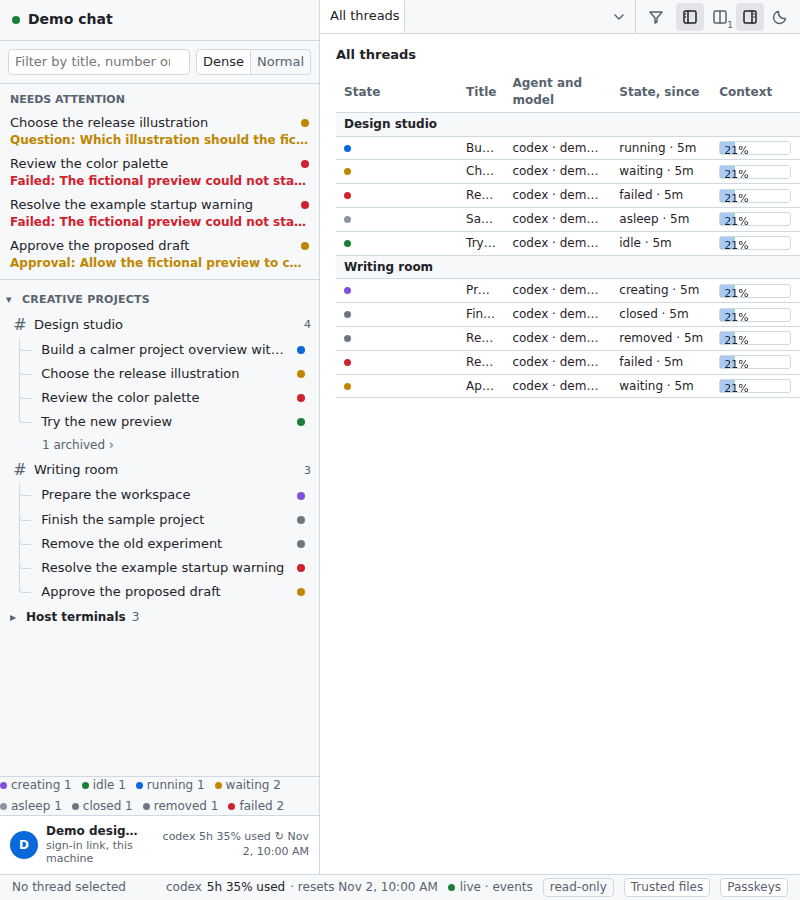

# Dashboard: the thread title column can shrink to almost nothing (#1019)

In the 800 px table, titles shrink to only a few characters while agent, branch and last-output columns retain 14ch minimum widths.

Keep at least 16ch of title content plus cell padding in the table. The pane scrolls horizontally when column minimums no longer fit; all columns/actions and the separate phone list stay unchanged.

## Evidence

All images use the isolated synthetic fixture of #1007; identifier text is omitted
after measurement. No installation data or configuration is used.

| Width | Before | After, light | After, dark |
| --- | --- | --- | --- |
| 1440 px | [Before](https://raw.githubusercontent.com/yousan/hataori/757f311/docs/notes/dashboard-1007/before/1440-light-en-list.png) | [After](after/1440-light-en-list.png) | [After](after/1440-dark-en-list.png) |
| 390 px | [Before](https://raw.githubusercontent.com/yousan/hataori/757f311/docs/notes/dashboard-1007/before/390-light-en-list.png) | [After](after/390-light-en-list.png) | [After](after/390-dark-en-list.png) |

### All after captures

- [1440-dark-en-list](after/1440-dark-en-list.png)
- [1440-light-en-list](after/1440-light-en-list.png)
- [390-dark-en-list](after/390-dark-en-list.png)
- [390-light-en-list](after/390-light-en-list.png)
- [800-dark-en-list](after/800-dark-en-list.png)
- [800-light-en-list](after/800-light-en-list.png)

## Wireframes rendered before source changes

Choose A: a 16ch minimum keeps a useful title while retaining more metadata in view at 800 px. B reserves 28ch and pushes the state/age column out of the viewport. Both keep every column available through pane scrolling.

- [A, 800-dark-en-list](wireframe-A/800-dark-en-list.png)
- [A, 800-light-en-list](wireframe-A/800-light-en-list.png)
- [B, 800-dark-en-list](wireframe-B/800-dark-en-list.png)
- [B, 800-light-en-list](wireframe-B/800-light-en-list.png)

## Validation

Pinned Node install/check (173 tests)/build, gofmt, go vet and focused page tests pass. Baseline title-width regression fails at 800 px (46.30 px). The fixed title is 149.59 px with a 138.16 px minimum, and real pane scroll reaches offscreen columns. At 1440 px the title remains 200.89 px and fits; phone list is unchanged. Both themes captured. Fresh Codex review found no issues. No local tmux tests.

Fresh independent Codex review: no findings.

Concurrency: Open PRs #1032, #1029, #1028, #1027, #1026, #1013 share styles.css/generated page files; each finding uses a separate source hunk and starts from current main. Old #990 shares CSS but is merged; remote branches were checked before the source edit.
