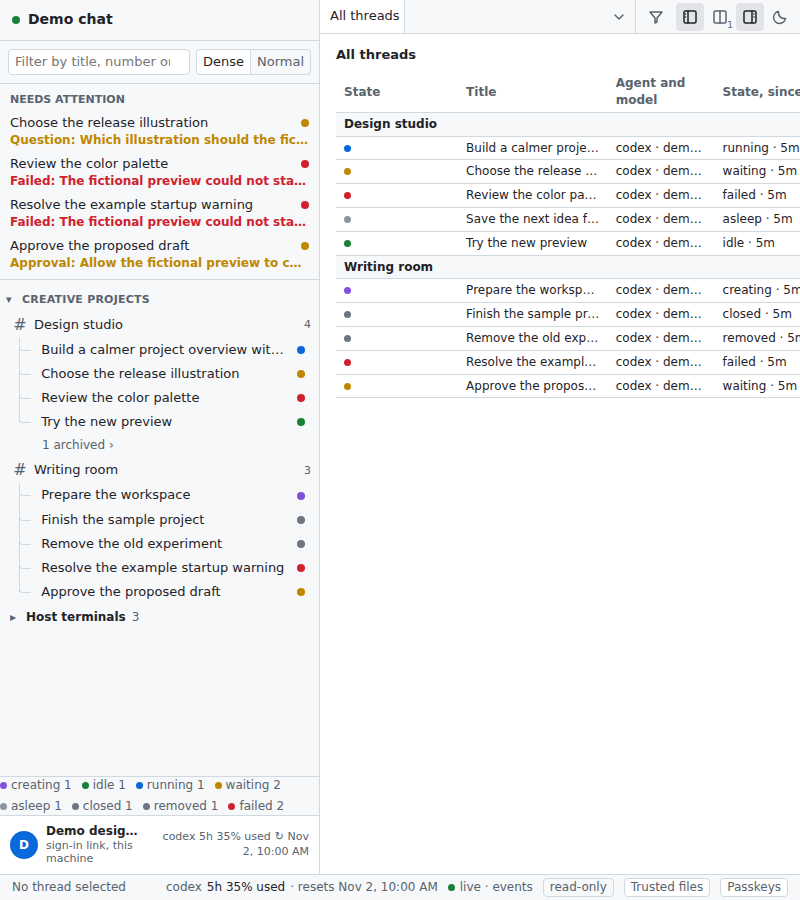

# Dashboard: the thread title column can shrink to almost nothing (#1019)

In the 800 px table, titles shrink to only a few characters while agent, branch and last-output columns retain 14ch minimum widths.

Keep at least 16ch of title content plus cell padding in the table. The pane scrolls horizontally when column minimums no longer fit; all columns/actions and the separate phone list stay unchanged.

## Evidence

All images use the isolated synthetic fixture of #1007; identifier text is omitted
after measurement. No installation data or configuration is used.

| Width | Before | After, light | After, dark |
| --- | --- | --- | --- |
| 1440 px | [Before](https://raw.githubusercontent.com/yousan/hataori/757f311/docs/notes/dashboard-1007/before/1440-light-en-list.png) | [After](after/1440-light-en-list.png) | [After](after/1440-dark-en-list.png) |
| 390 px | [Before](https://raw.githubusercontent.com/yousan/hataori/757f311/docs/notes/dashboard-1007/before/390-light-en-list.png) | [After](after/390-light-en-list.png) | [After](after/390-dark-en-list.png) |

### All after captures

- [1440-dark-en-list](after/1440-dark-en-list.png)
- [1440-light-en-list](after/1440-light-en-list.png)
- [390-dark-en-list](after/390-dark-en-list.png)
- [390-light-en-list](after/390-light-en-list.png)
- [800-dark-en-list](after/800-dark-en-list.png)
- [800-light-en-list](after/800-light-en-list.png)

## Wireframes rendered before source changes

Choose A: a 16ch minimum keeps a useful title while retaining more metadata in view at 800 px. B reserves 28ch and pushes the state/age column out of the viewport. Both keep every column available through pane scrolling.

- [A, 800-dark-en-list](wireframe-A/800-dark-en-list.png)
- [A, 800-light-en-list](wireframe-A/800-light-en-list.png)
- [B, 800-dark-en-list](wireframe-B/800-dark-en-list.png)
- [B, 800-light-en-list](wireframe-B/800-light-en-list.png)

## Validation

Pinned Node 24.22.1: npm ci --ignore-scripts, complete npm check (173 tests) with Node test-concurrency=1, npm run build; generated page rebuilt after main integration. gofmt, go vet (Go p=1) and focused TestThePage tests (-parallel=1) pass. Six refreshed synthetic captures cover 1440/800/390 px in both themes; desktop/tablet title minimum and actual pane scrolling checks pass, with phone list preserved. Baseline-failing evidence is preserved. No local tmux tests.

Fresh independent Codex review: landing_review_1019: fresh independent Codex review after current-main integration found no actionable findings; only title min-width and explanatory comment, existing scrolling/ellipsis and prior fixes preserved, no permission/input changes.

Concurrency: Resumed existing PR after rechecking open PRs and remote branches. Shared dashboard CSS/generated assets: #1054, #1050, #1047, #1042, #1039, #1013. Main fabd07b2 is integrated; previous findings stay on main and only this finding remains in this PR’s diff.
