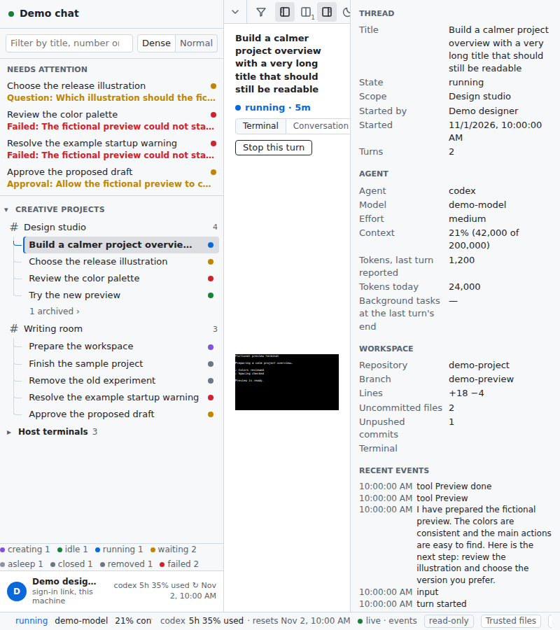
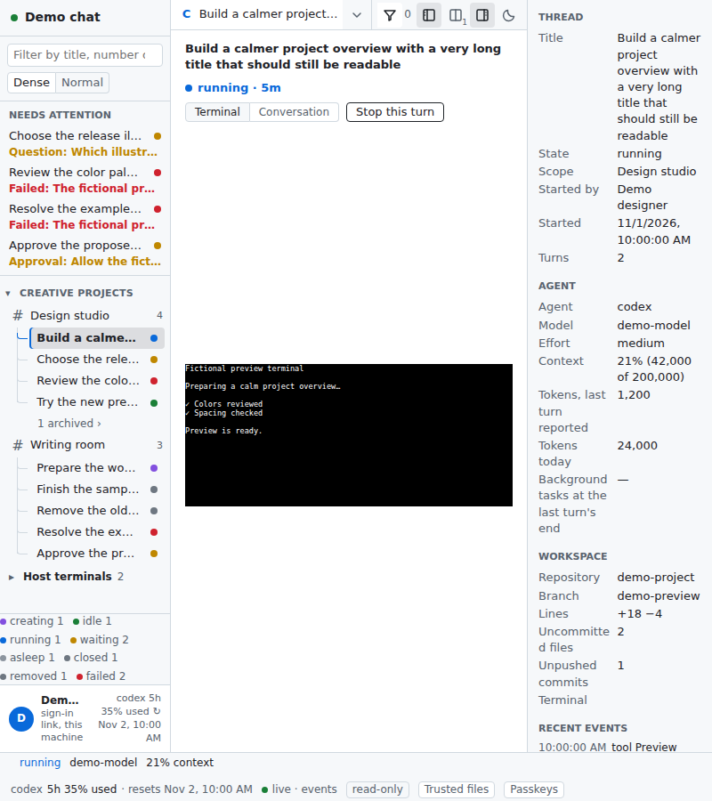

# Dashboard: fixed side panels squeeze tablet content and hide tools (#1020)

At 800 px, fixed side panels leave a 180 px center. Tabs vanish, the theme tool is clipped, the running title uses five lines and footer actions run off-screen.

Let sidebars scale continuously within their existing desktop maximum widths. The narrow sidebar header wraps its search and density controls, details labels shrink without colliding, and footer groups wrap while retaining reachable actions. No panel visibility choice or action changes.

## Evidence

All images use the isolated synthetic fixture of #1007; identifier text is omitted
after measurement. No installation data or configuration is used.

| Width | Before | After, light | After, dark |
| --- | --- | --- | --- |
| 1440 px | [Before](https://raw.githubusercontent.com/yousan/hataori/757f311/docs/notes/dashboard-1007/before/1440-light-en-running.png) | [After](after/1440-light-en-running.png) | [After](after/1440-dark-en-running.png) |
| 390 px | [Before](https://raw.githubusercontent.com/yousan/hataori/757f311/docs/notes/dashboard-1007/before/390-light-en-running.png) | [After](after/390-light-en-running.png) | [After](after/390-dark-en-running.png) |

### All after captures

- [1024-dark-en-long-status](after/1024-dark-en-long-status.png)
- [1024-dark-en-running](after/1024-dark-en-running.png)
- [1024-light-en-long-status](after/1024-light-en-long-status.png)
- [1024-light-en-running](after/1024-light-en-running.png)
- [1100-dark-en-long-status](after/1100-dark-en-long-status.png)
- [1100-dark-en-running](after/1100-dark-en-running.png)
- [1100-light-en-long-status](after/1100-light-en-long-status.png)
- [1100-light-en-running](after/1100-light-en-running.png)
- [1101-dark-en-long-status](after/1101-dark-en-long-status.png)
- [1101-dark-en-running](after/1101-dark-en-running.png)
- [1101-light-en-long-status](after/1101-light-en-long-status.png)
- [1101-light-en-running](after/1101-light-en-running.png)
- [1440-dark-en-long-status](after/1440-dark-en-long-status.png)
- [1440-dark-en-running](after/1440-dark-en-running.png)
- [1440-light-en-long-status](after/1440-light-en-long-status.png)
- [1440-light-en-running](after/1440-light-en-running.png)
- [390-dark-en-long-status](after/390-dark-en-long-status.png)
- [390-dark-en-running](after/390-dark-en-running.png)
- [390-light-en-long-status](after/390-light-en-long-status.png)
- [390-light-en-running](after/390-light-en-running.png)
- [721-dark-en-long-status](after/721-dark-en-long-status.png)
- [721-dark-en-running](after/721-dark-en-running.png)
- [721-light-en-long-status](after/721-light-en-long-status.png)
- [721-light-en-running](after/721-light-en-running.png)
- [800-dark-en-long-status](after/800-dark-en-long-status.png)
- [800-dark-en-running](after/800-dark-en-running.png)
- [800-light-en-long-status](after/800-light-en-long-status.png)
- [800-light-en-running](after/800-light-en-running.png)

## Wireframes rendered before source changes

Choose A: proportional clamped widths reclaim a 400 px center at 800 px and grow smoothly with the window, retaining the original 320/300 px panels at 1440 px. B fixes the narrow panels at 200/220 px and leaves them unnecessarily narrow at 1024 px, with a jump at its breakpoint. Both prototypes include the adaptive sidebar header and wrapping footer.

- [A, 1024-light-en-running](wireframe-A/1024-light-en-running.png)
- [A, 800-light-en-running](wireframe-A/800-light-en-running.png)
- [B, 1024-light-en-running](wireframe-B/1024-light-en-running.png)
- [B, 800-light-en-running](wireframe-B/800-light-en-running.png)

## Validation

Pinned Node install/check (173 tests)/build, gofmt, go vet and focused page tests pass. Baseline 800 px center is 180 px and a footer action is offscreen. After the fix centers are 341 px at721, 400 px at800, 512 px at1024, 550 px at1100 and 550.52 px at1101; 1440 retains820 px. Toolbar/footer controls are contained and hit-tested in both themes; 390 phone is captured. A long fictional model reproduced footer overflow before overflow-wrap:anywhere; it is contained after. No local tmux tests.

Fresh independent Codex review: no findings; follow-up confirmed long footer text wrapping after its reproduction.

Concurrency: Open PRs #1035, #1032, #1029, #1028, #1027, #1026, #1013 share styles.css/generated page files; each finding uses a separate source hunk and starts from current main. Old #990 shares CSS but is merged; remote branches were checked before the source edit.
